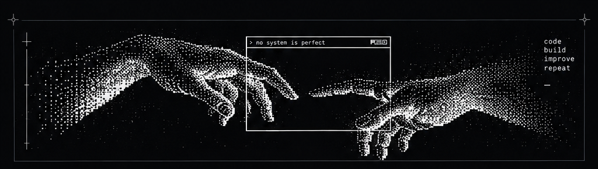
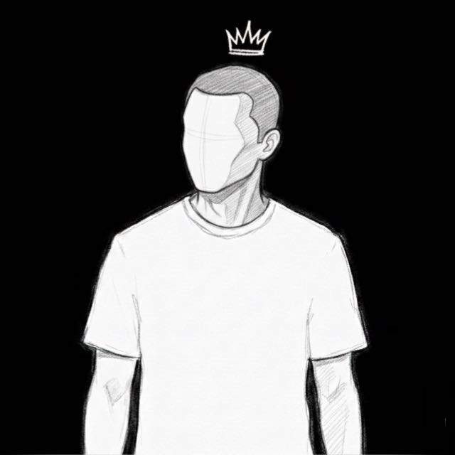

 

# Hi 👋, I'm Bruno

### Developer

**Learning Python and building projects.**

---

<table>
<tr>
<td width="60%" valign="top">

## 🚀 About Me

Olá! Sou o Bruno, estou aprendendo programação e gosto de explorar tecnologia criando meus próprios projetos.

Atualmente, meu foco é Python. Tenho interesse em bots, automação e desenvolvimento de sistemas.

Estou sempre buscando aprender coisas novas, melhorar minha lógica e transformar ideias em projetos reais.

### Interests

- Python development
- Bots & automation
- Software development
- Technology

</td>
<td width="40%" valign="middle" align="center">

</td>
</tr>
</table>

---

## 🛠️ Tech Stack

---

## 📊 GitHub Stats

---

## 📈 Activity Graph

---

## Connect

 

Keep learning. Keep building.

